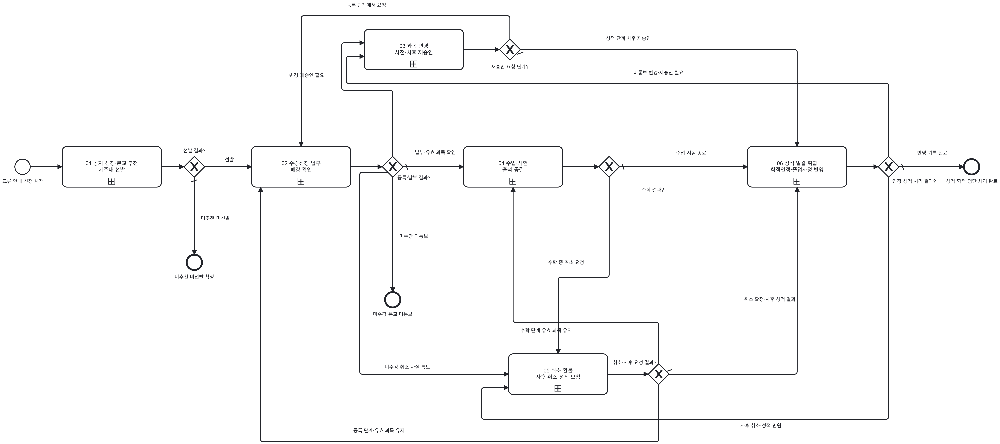
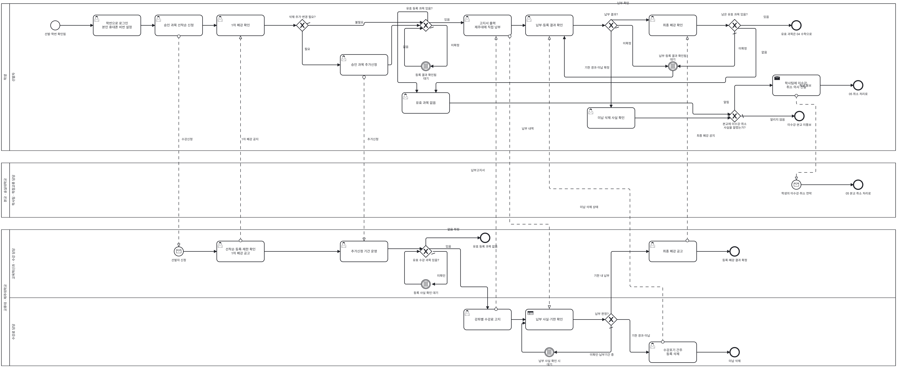
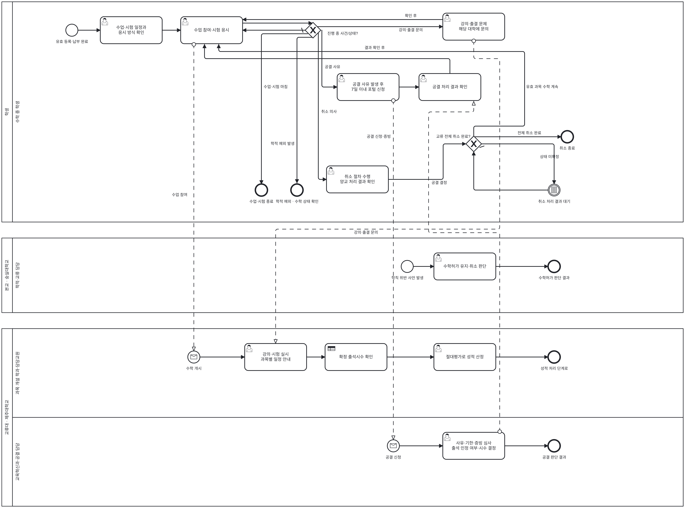
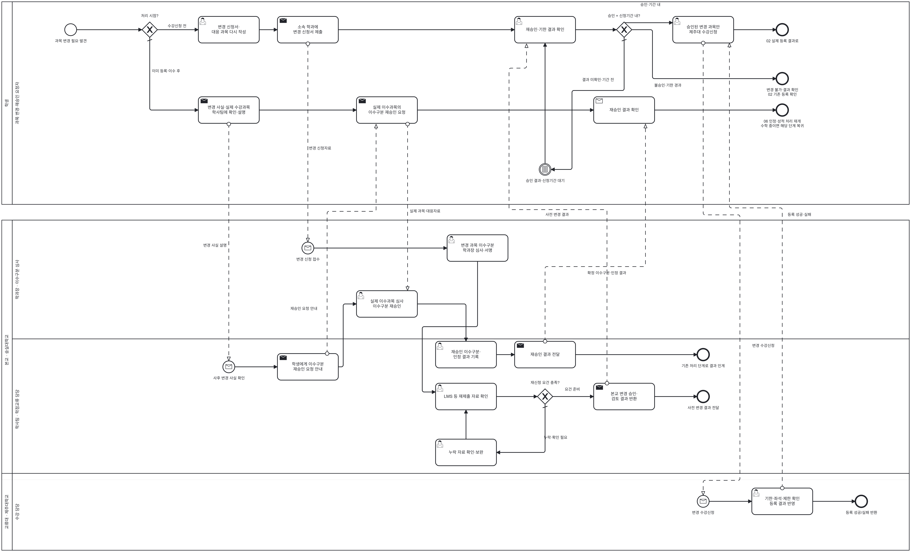
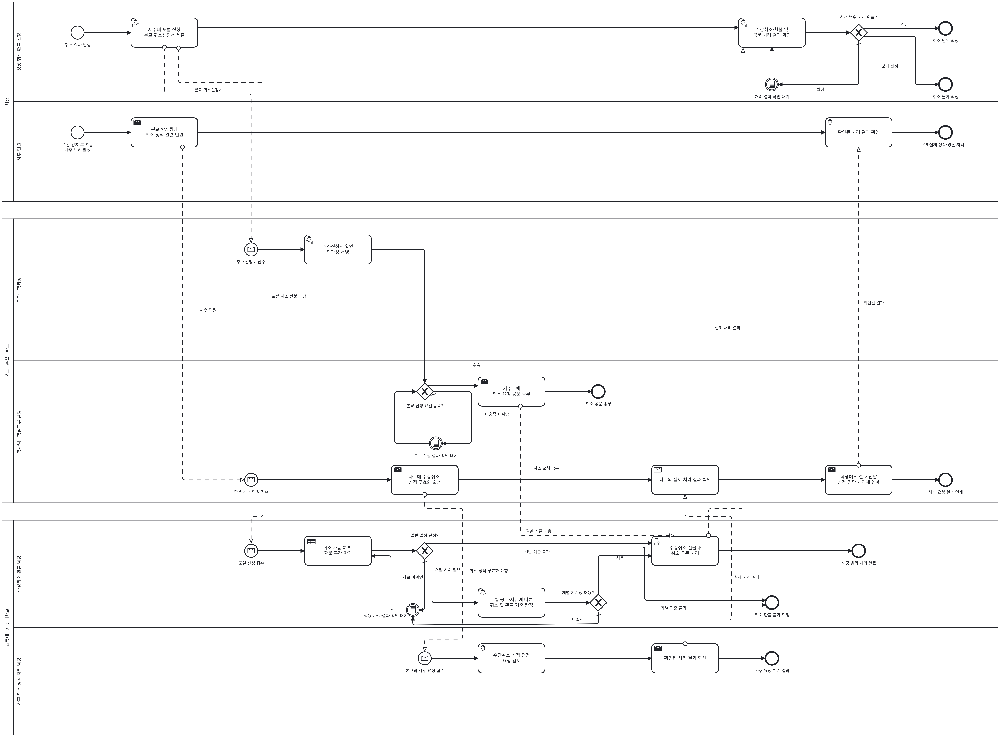

# 메인
1~6중 필요한 부분만 쓸지 전체를 다 쓸지
-> 위 사항 결정에 따라 \[03·05의 종료 이벤트를 고치고, 06번으로 들어가는 조건을 정리]

#전체

신청

수강신청   
if(??)  goto(수강,변경)

수업,시험,공결    
if(??)  goto(취소,환불)

성적확인

# 서브
수강변경

취소,환불

# 변경점
01. 신청·선발
- 학생이 학과장 승인과 서명을 받은 뒤, 학과에 서류를 제출하고 LMS에도 자료를 제출하는 절차를 반영
- 학사팀이 두 경로로 받은 자료의 일치 여부를 확인하고, 이수구분을 재점검
- 누락이나 오류가 있는 경우 학생에게 보완이나 재서명을 요청하고, 제출된 자료를 다시 확인
- 확인이 완료된 신청은 교류대학별로 취합하여 일괄 추천
  
02. 수강신청·납부
- 수강신청에 실패한 학생이 본교에 해당 사실을 알리면, 취소 처리로 이어지도록
- 교류대학의 등록 상태 변경이 본교에 자동으로 통보되는 구조는 반영하지 않았음
  
03. 과목 변경
- 수강신청 전에 변경 과목의 승인을 다시 받는 경우와, 이미 변경한 사실을 뒤늦게 발견하여 이수구분을 재승인받는 경우를 구분하여 반영
- 사전 승인이 없다는 이유만으로 학점 인정에서 즉시 제외하지 않고, 담당자 확인 및 재승인 절차
- 사전 변경은 수강신청 단계로, 성적 처리 중 발견된 변경은 재승인 후 성적 처리 단계로 돌아가도록
  
05. 취소·환불
- 일반적인 취소·환불 절차 외에, 학생이 수강을 방치하여 F학점을 받은 뒤 민원을 제기하는 경우를 추가
- 해당 경우 본교가 교류대학에 수강 취소 또는 성적 무효화를 요청하는 절차를 반영
- 본교의 요청이 반드시 수용되는 것은 아니므로, 교류대학의 검토 결과에 따라 후속 처리

06. 성적·학점 인정
- 본교가 해당 학기 파견대학들의 성적 공문을 모두 수합할 때까지 대기하는 과정을 반영
- 이후 과목 개설 → 학생 수강내역 등록 → 성적 입력 → 졸업사정 반영 절차를 담당 역할에 따라 구분
- 신청 과목과 실제 성적 자료가 일치하지 않는 경우, 학생에게 사실관계를 확인하고 필요한 이수구분 재승인을 받은 뒤 성적 반영

